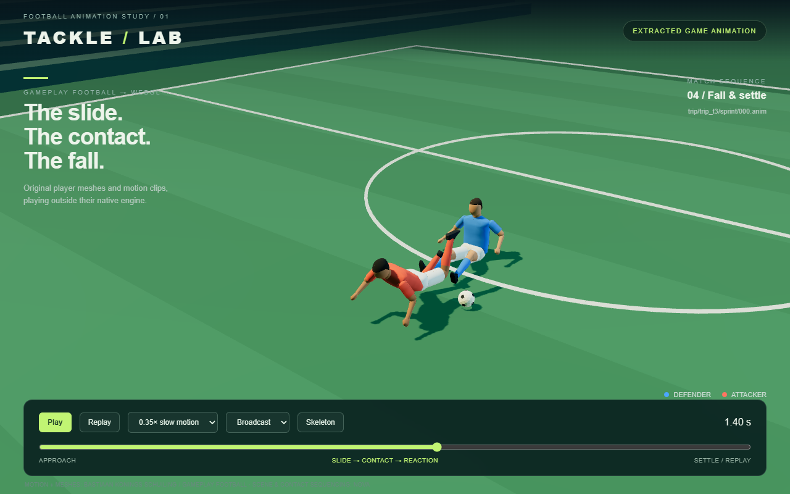

# Tackle Lab

**[Open the live demo](https://rblaurent.github.io/football-tackle-lab/)** · [Broadcast video](evidence/tackle-broadcast.mp4) · [Pitch-side video](evidence/tackle-pitch-side.mp4)



A working two-player tackling prototype built from **extracted Gameplay Football assets**, using the version included in Google Research Football. Original author: **Bastiaan Konings Schuiling**.

## Run the prototype

Unzip the package, open a terminal in its folder, and run:

```sh
python -m http.server 8080 --bind 127.0.0.1
```

Open `http://127.0.0.1:8080`. No npm installation or remote CDN is needed. Use a browser with WebGL support. Stop the local server with Ctrl+C.

Controls: choose a clean, late or missed tackle; play/pause, replay, 1x or 0.35x speed, scrub, switch cameras, or show the joint overlay.

## What was extracted

- Original 13-joint hierarchy and its rest offsets from `player.object`, plus the player root-motion track.
- Original ASE player meshes, including their separate skin, shirt, shorts, hair, sock and boot objects. All mesh vertices and triangles come from upstream; plain materials replace the original textures.
- Original sprint, slide-tackle, forward-trip and idle quaternion keyframes.
- Native root translation and vertical motion, using the source's 100 Hz frame convention and XYZW quaternions.
- The slide clip's football-contact marker at source frame 32.
- The full upstream library: 293 `.anim` files, exported to `animation-library.json` and preserved verbatim under `upstream/data/media/animations`.

The upstream sprint template is a half stride. The demo mirrors the joint names and quaternion components to produce its other half; the GLB contains both the original half stride and the completed run cycle.

## What this prototype adds

Three.js rendering, materials, pitch, lighting, camera tracking, quaternion interpolation and brief pose crossfades. The current demo adds a deterministic contact simulation at 120 Hz. Foot, shin, thigh and torso capsules follow the extracted joints. A continuous sphere-versus-capsule sweep catches fast ball contacts, transfers moving-foot velocity, then applies gravity, ground bounce and rolling drag. Possession guides the ball until a challenge or the owner falls. Root alignment predicts the source leading boot near its contact marker, while upper-body overlap correction keeps the solid torsos apart. Actual limb contacts trigger the fall clip; clean and missed tackles do not trigger a fall.

This is an extracted animation player with a small new contact solver. It does **not** run FIFA/PES code or Gameplay Football's native match AI, animation search/selection, collision, foul adjudication, foot IK, or recovery logic. The tackle classifier is a gameplay heuristic based on ball-first versus limb contact, closing speed and contact height; it is not a complete implementation of football's laws. High or forceful contact can still be flagged after touching the ball. Limb rotation is sampled at the fixed timestep; moving ball sweeps approximate capsule motion as translation during each substep. It holds ending slide/fall poses, then replays.

## Reusable assets

- `football-player-animations.glb`: the original articulated player and five clips: source half-stride, full run cycle, slide, fall, idle. A parent transform converts native Z-up to glTF Y-up. Body parts are rigid meshes animated by their parent joints, matching this source asset's hierarchy; this is not an automatically retargeted Humanoid skin.
- `extracted.json`: the original meshes, joint hierarchy, four source motion clips, metadata and SHA-256 hashes used by the demo.
- `animation-library.json`: all 293 source clips in the same portable track format, with each source file's SHA-256.
- `upstream/`: the original source files, exact revision and verified Git blob identifiers in `SOURCE.json`.
- `fetch_source.py`: fetch the pinned source files and verify every file against Git's blob hash.
- `extract.py`: reproducible `.anim` / `.object` / ASE conversion, with key ordering, quaternion and mesh index validation.

To reproduce extraction with Python 3:

```sh
python fetch_source.py upstream
python extract.py upstream . --all
```

## Provenance and licensing

Upstream repository: https://github.com/google-research/football

Pinned revision: `3d9e754720a95621bba6475c4d3b0d56fe919014`.

The extracted files are under `third_party/gfootball_engine/`, whose supplied license is the Unlicense. A copy is included as `LICENSE-GAMEPLAY-FOOTBALL.txt`. The Google research wrapper has its own license; it is not used by this prototype. Three.js and its GLTFExporter retain the MIT license included in `vendor/LICENSE-THREE.txt`.

The demo scene, extraction scripts and original orchestration code in this package may also be used under the Unlicense. Attribution to the original author is retained as provenance.

## Captures

The original `tackle-broadcast.mp4` and `tackle-pitch-side.mp4` preserve the first staged animation extraction study. The current `collision-clean.mp4` and `collision-late.mp4` show actual contact-driven outcomes at 1280×800 / 30 fps, with normal-speed and slow replays. These are browser renders of the extracted assets, not generated video.

See `verification.json` for browser-control checks, capture metadata and GLB validation. Visual quality and contact staging are a prototype, not FIFA 2010 parity.


## Collision checks

Run `node --test physics.test.mjs`. Tests cover fast-ball tunneling, near misses, crossed and degenerate capsules, rebound impulses, moving-foot momentum, ground support and dangerous contact after ball-first. Browser checks verify all three distinct outcomes, finite ball trajectories and ground support. See `collision-verification.json`.

The design is informed by the general approach discussed in [Animation Warping for Responsiveness in FIFA Soccer](https://gdcvault.com/play/1012464/Animation-Warping-for-Responsiveness-in): adapt motion to the gameplay situation. This is a small independent implementation, not EA code.

