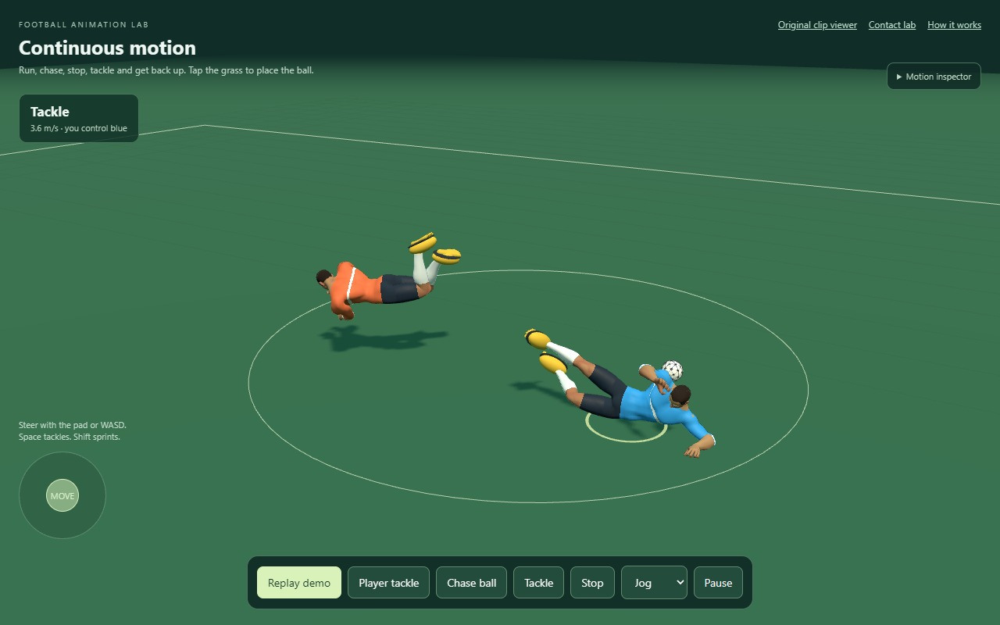

# Football Tackle Lab

**[Play the continuous controller](https://rblaurent.github.io/football-tackle-lab/)** · [Original clip viewer](https://rblaurent.github.io/football-tackle-lab/clips.html) · [Complete setup/extraction handoff](docs/START-HERE.md)

[Watch the 18.5-second controller capture](evidence/controller-motion.mp4)



A small, playable football animation system using selected **native FC 27 Lite motions** on proper skinned human characters. It can idle, start, walk, jog, sprint, stop, turn, chase a ball, tackle, fall and get back up. The home page runs the latest controller; the original eight-scene clip viewer and earlier collision experiment are preserved.

The new controller has phase-aligned speed blends, pose-matched entries/get-ups, interruptible inertial transitions, bounded foot planting, animated foot/ball and foot/leg contact, and a two-player tackle scenario. It uses **recovered FC knee-IK neural weights** as a bend hint for an analytic two-bone solve. The state machine, navigation, blending and contact logic are original project code. It does not run EA's native motion-matching engine or complete match simulation.

## Play

Steer blue with WASD/arrows or the touch pad. Shift sprints; Space tackles. Use Chase ball, Stop and the pace selector. Tap the grass to place the ball, or press Player tackle for an arranged two-player encounter. Both players recover automatically. Drag/pinch to orbit/zoom and open Motion inspector to see the current action and weights.

## Run locally

```sh
git clone https://github.com/rblaurent/football-tackle-lab.git
cd football-tackle-lab
python -m http.server 8080 --bind 127.0.0.1
```

On macOS use `python3` if necessary. Open `http://127.0.0.1:8080`. Playback requires no build, npm install, account, remote CDN or installed game. Do not open the HTML with `file://`.

## Build on it

**[Start here](docs/START-HERE.md)** for the complete friend/AI handoff. **[Controller, transitions and recovered weights](docs/CONTROLLER.md)** documents every new layer, what was extracted versus implemented, the exact reproduction commands, source formats, numerical evidence and remaining limitations.

The expanded extraction profile decodes 22 selected clips and inspects 33 controller/weight assets. `controller-data.json` holds thirteen runtime clips; `data.json` preserves the original eleven. Three recovered neural IK models are in `research/fc27-neural-ik.json`; only the knee model is used in the live controller. The motion library and full FC runtime have not been extracted.

Knee, elbow and Spine3 networks were checked against 240 native idle/walk/jog/sprint poses each. Knee reconstruction has 2.47 cm RMSE per coordinate; this is an inferred convention checked against extracted clips, not EA runtime equivalence. Sixteen Node tests and desktop/touch browser acceptance cover the new state sequence and contacts. See `evidence/` for reports. Phone emulation was tested; physical phones and Mac/Safari were not.

## Original studies

- [`clips.html`](clips.html): native paired tackle and front/side shirt pulls, untrimmed gameplay slides, standalone recovery and idle. It retains source trajectories and timing; it is a capture viewer, not the new controller.
- [18-second original motion capture](evidence/fc-lite-human-motion.mp4): the earlier skinned-character extraction showcase.
- [`collision-lab.html`](collision-lab.html): earlier independent Gameplay Football clean/late/missed challenge simulation. [Technical notes](GAMEPLAY-FOOTBALL.md).

## Terms

Original project code is Unlicense, Quaternius human meshes/hair are CC0, and Three.js is MIT. **FC-derived motions, skeleton, controller data and neural weights are separate and are not covered by those licenses; no redistribution permission is asserted for them.** No installed game, native EA runtime, Oodle binary, FMT binary or third-party reference codec source is included. Read [THIRD_PARTY.md](THIRD_PARTY.md). This independent experiment is not endorsed by EA or FIFA.
