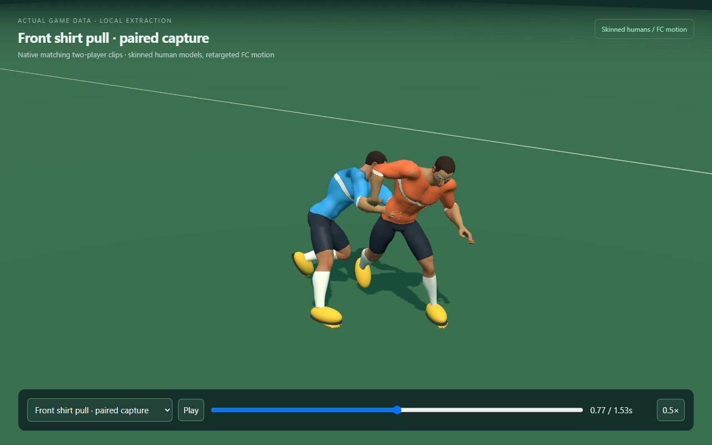

# Tackle Lab

**[Open the live demo](https://rblaurent.github.io/football-tackle-lab/)** · [18-second motion video](evidence/fc-lite-human-motion.mp4) · [Earlier ball/contact demo](https://rblaurent.github.io/football-tackle-lab/collision-lab.html)



An interactive football animation study using **actual selected FC 27 Lite motion clips**, retargeted onto a proper skinned human model. The athletic characters have a continuous body mesh, face, finger bones, hair, team shirts, shorts, socks and boots. The human mesh and hair are Quaternius CC0 assets; kit shading and boots are original project additions.

## Complete developer handoff

**[Start here: setup, extraction, formats, tools and AI guide](docs/START-HERE.md).** The handoff includes a runnable Windows extractor, pinned codec bootstrap, named rig bindings, validation/comparison tools, portable browser capture scripts and the remaining game work. It does not require access to the original chat or machine.

## Try it

Open the live page on a WebGL-capable desktop or phone browser. Choose a scene, play/pause, scrub the timeline, switch between half/normal speed, and drag or pinch to orbit/zoom.

Scenes:

- Native paired cinematic tackle.
- Native paired gameplay front and side-on shirt pulls.
- Gameplay sprint and 45-degree slide tackles.
- Actual ground-to-standing recovery.
- A tackle/fall stunt and standing idle.

The paired clips retain their original timing and shared trajectories. The human proportions differ from the source player, so contact is approximate; the viewer does not add hand/foot contact IK or jersey deformation. The recovery is a separate clip, not a completed automatic tackle-to-recovery transition.

## What runs here

Three.js drives a 65-bone human skin from a 369-bone source render rig. Only the channels used by each clip are animated: gameplay samples have 34 quaternion, 12 vector and 8 scalar channels; the cinematic/idle samples have 74/14/8. Source positions are converted from feet to meters. Retargeting transfers world rotation deltas and corrects different rest-pose limb directions. Native quaternion samples interpolate at a 30 Hz source frame convention.

This is extracted motion playback and retargeting. EA's native animation selection, collision solver, physics, match AI and foul decisions are not included. The new viewer plays source captures; it does not simulate their contacts. The separate [earlier collision prototype](collision-lab.html) retains the independent ball/player solver and clean/late/missed outcomes from the Gameplay Football study. See [its technical notes](GAMEPLAY-FOOTBALL.md).

`data.json` contains eleven selected decoded clips and the render rig. The complete FC library has not been exported or verified. The source name `f16_idle_front_getup_02` is misleading: it visibly plays standing idle. The actual recovery shown is `f22_d012011trej002_atcp_fall45r_jogsl_getup`.

## Run locally

No build, npm installation, remote CDN or account is required:

```sh
python -m http.server 8080 --bind 127.0.0.1
```

Open `http://127.0.0.1:8080`. Stop the server with Ctrl+C.

## Validation and captures

The 18.1-second H.264 video is a deterministic browser capture at 1280x800 / 30 fps, with source motion played at half speed. It shows the tackle, front/side shirt pulls, angled slide and recovery. It is rendered footage, not generated video.

`fc-motion-verification.json` records eight scenes at start/mid/end, checking finite skin matrices and no browser page errors. `fc-phone-verification.json` records a 412x915 touch viewport with scene selection, timeline scrubbing and WebGL rendering. This is emulation; actual phone/Mac hardware has not been tested. Earlier contact-physics checks remain available with `node --test physics.test.mjs`.

## Credits and terms

Read [THIRD_PARTY.md](THIRD_PARTY.md) before reusing anything. The original project code uses the Unlicense. Quaternius human meshes/hair use CC0 and Three.js uses MIT. **The FC-derived motion/rig data is not covered by the Unlicense; no redistribution permission is asserted for it.** No native EA runtime code, proprietary extraction tool or decompression library is included.

This independent research prototype is not affiliated with or endorsed by EA or FIFA.
