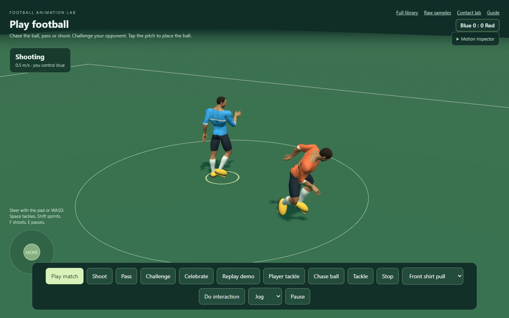

# Football Tackle Lab

**[Play football](https://rblaurent.github.io/football-tackle-lab/)** · [Animation-system guide](docs/ANIMATION-SYSTEM.md) · [Friend/AI handoff](docs/START-HERE.md) · [Download source and playable data](https://github.com/rblaurent/football-tackle-lab/archive/refs/heads/main.zip)

A playable two-player football animation foundation for a small manager/referee game. Proper skinned human characters select and stream suitable native FC motions from **2,313 measured body clips across 17 action families**. Starts, running, braking, turns, ball pursuit, kicks, tackles, falls, get-ups, standing interactions and celebrations share one controller.

[Watch one continuous gameplay sequence](evidence/runtime-gameplay.mp4): approach, shot, physical goal, celebration, then push and contact-triggered reaction in the same world.



## Play

Steer blue with WASD/arrows or the touch pad. Shift sprints, Space tackles, F shoots and E passes. Play match enables the opponent's pursuit/interception behavior. Pass and Shoot approach the ball and select a native kick; the animated foot must actually contact it. A goal queues celebration after the follow-through.

Challenge selects a standing encounter from relative angle, distance and pace. The Interaction selector also gives direct access to front/side shirt pulls, arm grabbing, pushing and handball. Both players approach, act, release and return to movement; Stop cancels. Player tackle sets up a repeatable slide encounter. Tap the pitch to place the ball, drag/pinch to orbit/zoom, and open Motion inspector to inspect actual source names and selection/streaming state.

## Run locally

```sh
git clone https://github.com/rblaurent/football-tackle-lab.git
cd football-tackle-lab
python -m http.server 8080 --bind 127.0.0.1
```

On macOS use `python3` if necessary. Open `http://127.0.0.1:8080`. Playback needs no build, npm install, account, remote CDN or installed game. Use HTTP rather than opening the HTML directly.

## How it works and what was extracted

The **[animation-system guide](docs/ANIMATION-SYSTEM.md)** documents automatic selection, feature measurements, asynchronous streaming/cache, transitions, root ownership, contact, recovery, goals, every new tool and extension instructions. The runtime's selector weights, state machine, blending and physics are original project code. It does not run EA's native animation engine or constitute a complete football match simulator.

Native shirt-pull pairs retain their shared capture frame and clock. Push combines a native pusher and a separately selected native reaction at physical hand/torso contact. Arm grabbing and handball use native body performances with authored hand/arm adaptations; those complete interactions are not claimed as recovered native paired captures. Recovered FC knee-IK weights provide a bend hint for an analytic two-bone solve.

**[Browse the entire extraction catalogue](https://rblaurent.github.io/football-tackle-lab/library.html)**: 46,351 discoverable installed animation resources, including victory and celebrations. 44,037 decode; 2,314 retain explicit unsupported-codec status. The whole extraction and original files live in the local ignored `native-library/` export, which is separate from the source ZIP. The ZIP includes the measured runtime pack and 338 additional catalogue previews. **[Full extraction/setup guide](docs/FULL-LIBRARY.md)** explains how to reproduce or transfer the complete export.

## Verification

47 Node tests cover controller regressions, selection, actual native kick/contact misses, every connected interaction, eight rotated tackles, streamed gait continuity, integrity failure fallback, cache eviction, and a full approach/shot/goal/celebration sequence. Desktop and emulated-touch browser acceptance checks rendered skeletons, controls, action release, layout and asset failures. Physical phones and Mac/Safari have not been tested.

Every shipped runtime payload has been checked for hash integrity, binding/shape, finite samples and quaternion norms, and byte-for-byte equality to its decoded source frame range. See [evidence](evidence/README.md). This is a two-player foundation; team tactics, goalkeepers, richer airborne actions and full referee rules remain work.

## Further documentation and earlier studies

- [Start here](docs/START-HERE.md): setup, extraction routes and AI handoff.
- [Original controller/IK guide](docs/CONTROLLER.md), [formats](docs/FORMATS.md), [tools and provenance](docs/TOOLS-AND-SOURCES.md), [interaction details](docs/INTERACTIONS.md).
- [Original source-clip viewer](https://rblaurent.github.io/football-tackle-lab/clips.html): captured paired tackles, shirt pulls and selected motions.
- [Earlier contact experiment](https://rblaurent.github.io/football-tackle-lab/collision-lab.html) and [Gameplay Football notes](GAMEPLAY-FOOTBALL.md).

Original project code is under [the project license](LICENSE). Third-party code, models and extracted motion data retain their own provenance and rights; the code license does not grant rights to EA data. See [third-party provenance](THIRD_PARTY.md).
