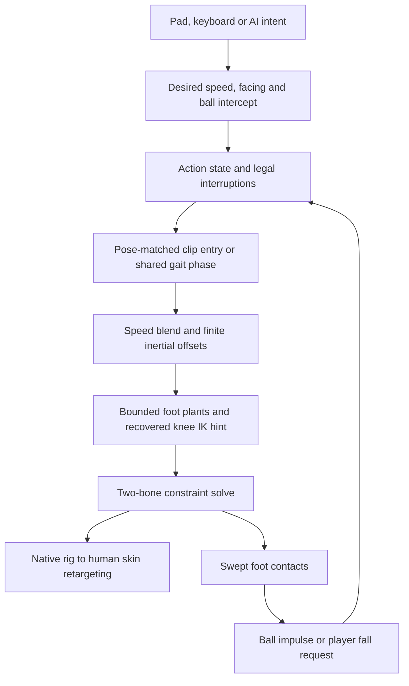

# Continuous football motion: controller, extraction and neural IK

**Live animation-system update:** the home page now automatically selects and streams from 2,313 measured native body clips, with continuous gait/action transitions, contact-driven passing/shooting, native pushes/reactions and goal celebrations. [Architecture, setup, tools and AI guide](ANIMATION-SYSTEM.md). Earlier fixed-subset descriptions below are historical implementation context.


This is the continuation of the [original extraction handbook](START-HERE.md). The public home page now runs a small, controllable football animation system. The old eight-scene capture viewer is preserved at [`clips.html`](../clips.html), and the older Gameplay Football contact experiment remains at [`collision-lab.html`](../collision-lab.html).

**[Play](https://rblaurent.github.io/football-tackle-lab/)**. The automatic demo chases a rolling ball, stops, changes direction, slides for the ball, gets up, walks and settles into idle. **Player tackle** starts a separate two-player encounter: an animated foot hits the opponent's leg capsule, the opponent falls, and both players recover. You can steer with WASD/arrows or the touch pad, hold Shift to sprint, select walking/jogging/sprinting, chase the ball, stop, and tackle with Space/the button. Tap the grass to place a new ball. Drag/pinch the scene to orbit/zoom. Open Motion inspector to see states, weights and foot planting.

This is a working foundation for a small referee/manager game. It is not a recreation of a complete FC match engine. Read the limitations at the end before building on it.

**Current hand/incident controls:** see [INTERACTIONS.md](INTERACTIONS.md) for front/side shirt pulls, arm grabbing, pushing and a contact-triggered handball block in the same lab. It also documents the neutral idle gaze and rendered boot support correction.

## The distinction that matters

There are three different kinds of information here:

| Layer | Recovered from FC Lite | Implemented by this project |
| --- | --- | --- |
| Motion | Native clips, player rig, named channels, trajectories and foot height/velocity scalar tracks | Clip trimming, gait phase alignment, loop seam correction, sampling and retargeting |
| Selection/control | PTM controller references, embedded blend/phase/warp/time settings, feature schemas, feature weights and current-animation biases | Intent/state logic, our small pose matcher, speed blends, transition durations, navigation and ball pursuit |
| Neural IK | Three complete locomotion IK networks, dense matrices, biases, activation slopes, normalization bounds and input/output names | Standalone inference, inferred coordinate/layout conventions, bounded foot locks and two-bone solving |
| Contacts | Captured motions; the selected clips do not themselves define our collision solver | World/body separation, foot/leg sweeps, ball impulses, tackle trajectory correction and fall/recovery dispatch |

**The live controller does not run FC's native PTM database search or its 31-component cost function.** Its gait mixing, pose selection and state graph are ours. The knee network weights used for foot-plant bend hints really are the extracted FC weights. This does not mean we recovered every neural system, ML-Flow, the whole HyperMotion runtime, collision policy, training data, or the game's executable logic.

## What FC's data actually shows

The read-only probe used the installed PC Lite build described in [REPRODUCING.md](REPRODUCING.md): Steam build 22116598, game 1.0.142.20665. No game process, anti-cheat component, or executable patch is involved.

The expanded extraction profile decodes **22 selected clips**: the original eleven plus eleven locomotion/recovery candidates. The runtime controller uses seventeen of these. Some other candidates were useful to inspect but are not chosen by the running controller. `data.json` remains the original eleven-clip dataset; `controller-data.json` is the seventeen-clip runtime subset.

The optional controller extraction reads **33 named EBX assets** and resolves their embedded objects. The exact names, decoded/packed SHA1s, class GUIDs, fields, references and unresolved fields are in [`research/fc27-controller-assets.json`](../research/fc27-controller-assets.json). The report's `rawFile` fields refer to private local extraction outputs, not public repository files. No raw game archives, native SDK binaries or Oodle library are shipped.

Concrete recovered structures include:

- `antifreeze/assets/gameplay/locomotion/ptm/ptm_locomotion_controller`, with references to motion-database, scaling, blend, interrupt, phase-filter, locomotion-filter, time-scale, foot-warp, motion-warp, joint and pose-correction parameter objects.
- `.../locomotion/ptm/database/ptm_db/ptm_database_normal_f27_foundation`, containing a master database and five embedded PTM database objects. This is data, not an independently executing search engine.
- `.../ptm_database_normal_fwd_weights_f25`, `.../ptm_database_normal_start_weights_f21` and `.../ptm_database_drasticturn_weights_f25`, with feature-component weight vectors and current-animation biases.
- `_af/154bb3f3-5446-b997/pfa_ptm_database_normal_upgrader`, defining 31 valid feature components, padded to 32, with seven schema references.
- Native locomotion knee, arm and chest DNN IK models.

The tested embedded `PTMBlendParamsAsset` contains `BlendTicks=24`, `MaxActiveBlends=3`, `PoseFeaturesBlendTicks=8`, `BlendType=0` and `VelocityWeight` approximately 0.3. Crucially, it also points to `float_loco_blend_ticks`, whose stored default is **14**. The max/min time-scale overrides have stored defaults of approximately **1.05** and **0.85**. These are serialized defaults and override relationships; they are not a recording of the effective values during a running match. We have not established the tick unit, so do not casually convert 14 or 24 to seconds using the clip's 30 Hz timebase.

The forward/start/drastic-turn weight assets use a serialized squared-L2 metric enum. The observed current-animation biases are approximately **0.05 / 1.5 / 1.0**, respectively. These are evidence that retaining the current motion is explicitly controlled, rather than jumping to whichever clip happens to have the lowest instantaneous pose error. The report preserves duplicate named families under both normal and `_af` paths; do not assume they are interchangeable instances.

The seven feature ranges are:

| Component indices | Schema |
| --- | --- |
| 0-1 | Motion-type fields |
| 2-15 | Retained trajectory components |
| 16-18 | Left-foot position |
| 19-21 | Left-foot velocity |
| 22-24 | Right-foot position |
| 25-27 | Right-foot velocity |
| 28-30 | Hips heading-Y schema |

The offsets are directly stored as `[0,2,16,19,22,25,28]`. Foot and heading schemas also preserve their joint/reference-joint pointers and stripped-component flags. The trajectory schema keeps fourteen components and strips eight others. **The exact order, normalization and meaning of every trajectory scalar has not been reconstructed.** Do not copy these 31 weights onto a different feature vector and claim equivalent selection. Our runtime matcher deliberately uses its own small joint-angle/hip-height metric.

### A schema trap we found

The public FMT FC26 SDK identifies many matching class GUIDs and useful field layouts. **A matching GUID does not guarantee that FC27 has the same layout.** FC27's root locomotion-controller object grew relative to the older schema. Reading its old scalar offsets produced plausible-looking nonsense, including integer bit patterns interpreted as tiny floats.

The portable reader therefore deliberately skips interpreting that root object's fields. It still identifies the root class and decodes the separate embedded parameter structures where the structural checks work. Unknown classes and unsupported/bad fields remain explicit in `unresolved`. The current report has 46 unresolved fields, including the skipped root layout. This is a bounded, partial inspector, not a complete universal EBX SDK.

Class metadata was inspected using public FMT release 26.10.9654.14105's FC26 SDK and ILSpy 9.1.0.7988. Only factual field metadata is packaged in `tools/fc27/controller-schema.json`; SDK/decompiler binaries and decompiled third-party source are not vendored. The original archive/codec pipeline, versions and pinned source are documented in [TOOLS-AND-SOURCES.md](TOOLS-AND-SOURCES.md).

## The recovered neural weights are usable

[`research/fc27-neural-ik.json`](../research/fc27-neural-ik.json) includes complete ordered layer data:

| Model | Dense dimensions | Dense coefficients | Inputs / outputs |
| --- | --- | --- | --- |
| `knee_loco_dnn` | 7 → 16 → 16 → 16 → 6 | 720 | Both foot XYZ positions and hips height → both knee XYZ positions |
| `arm1_loco_dnn` | 16 → 28 → 24 → 20 → 6 | 1,720 | Both hands, both upper arms, Spine3 XYZ and hips height → both elbow XYZ positions |
| `chest_loco_dnn` | 7 → 16 → 8 → 8 → 3 | 328 | Both upper arms XYZ and hips height → Spine3 XYZ |

Each network has eight ordered layers: four dense layers and four LeakyReLU layers, including an output activation. Biases, per-node slopes, input/output bounds, and names are included separately from the coefficient counts. The observed negative slopes are approximately 0.2. Native layer enum 0 is dense and 1 is LeakyReLU. Do not label it a PReLU layer just because slopes are stored per node.

RIFF internal object references required special care: the low word holds a **signed 32-bit relative offset**. A negative reference read as an unsigned 64-bit displacement appeared to point 4 GiB past the file. The cleaned reader validates every internal pointer against the EFIX object-offset list, then follows the network's `Layers` array in its stored order. Disk order is not execution order.

The following convention was inferred experimentally and is implemented in [`neural-ik.js`](../neural-ik.js):

1. Convert the relevant joint world positions into the animated hips' local coordinate frame: `inverse(hipsWorldRotation) * (jointWorldPosition - hipsWorldPosition)`.
2. Convert metres to native feet by dividing by 0.3048. Append hips world Y in feet for the named `HipsY` input.
3. Normalize each input with `(x - inputMin) / (inputMax - inputMin)`. There is no automatic clamp to [0,1].
4. For a dense layer, use **input-major** coefficients: `out[j] = bias[j] + sum(input[i] * weights[i * numNodes + j])`.
5. Apply `x < 0 ? alpha * x : x` for LeakyReLU.
6. Denormalize with `out * (outputMax - outputMin) + outputMin`. Convert the resulting hips-local points back through the hips transform and feet-to-metres scale.

We compared candidate matrix orientations and normalization ranges against decoded native gait poses. Knee reconstruction with this convention has **0.0247088 m RMSE per coordinate** across 240 sampled idle/walk/jog/sprint poses. The same convention gives approximately **0.0394835 m** for elbows and **0.0203679 m** for Spine3. Full results, including maximum joint errors, are in [`evidence/neural-ik-reconstruction.json`](../evidence/neural-ik-reconstruction.json). Knee maximum joint error is about 0.235 m; a low aggregate error is not a guarantee for every pose.

This is reconstruction against extracted clips, **not a comparison with EA runtime outputs**. Limb placement can be ambiguous, the evaluation is small, and training coverage is unknown. The live controller uses only the knee model, as a bounded bend hint; exact limb lengths and final foot placement come from our analytic two-bone solve. The arm and chest models are supplied for further investigation, not silently applied in the demo.

Reproduce the numerical check:

```sh
node tools/verify-neural-ik.mjs --out neural-check.json
```

## Our runtime architecture



The files have narrow jobs:

| File | Job |
| --- | --- |
| `animation.js` | Native sampling, closed gait cycles, pose entry/recovery matching, speed blending and inertial transitions |
| `controller-core.js` | 120 Hz world, intents, action states, root integration, ball prediction, bounded tackle correction and contacts |
| `neural-ik.js` | Shape validation and small dense/LeakyReLU inference |
| `foot-planting.js` | World-space foot locks, gradual release, neural knee hints and fixed-length two-bone IK |
| `human.js` | Reusable skinned model, kit/boots/hair and native-to-human retargeting |
| `controller-view.js` | WebGL scene, phone/desktop input, camera, UI and evidence hooks |
| `controller.test.mjs` | Behavioral regression checks for the integrated system |

### States and interruptions

The main path is `idle → start → move → stop → idle`. A large heading change while moving can use a turn action. Chase is an intent feeding this same controller, not a separate animation player. A tackle locks the short attack sequence, enters pose-selected recovery, then returns to movement if movement was requested, otherwise brakes through stop when still moving before idling. A victim follows `fall → recover → stop → idle` in the arranged duel, or resumes requested movement. Repeated tackle requests are rejected while tackle/fall/recovery is locked.

A ball chase uses a bounded prediction horizon, desired heading, acceleration/deceleration and arrival hysteresis. Entering the near-ball waiting region does not repeatedly restart the player every time the distance crosses a single threshold. When the ball moves far enough away, pursuit resumes. This is simple steering, not FC's player/team AI or a guaranteed interception solver.

Every transition is captured from the **currently displayed blended pose**, so interrupting one transition with another does not return to an old clip pose. A finite Hermite offset fades from the outgoing position/rotation difference to zero over the transition. Position and quaternion-log velocity differences account for the incoming motion. Rotational derivative matching is approximate in local quaternion-log space. It preserves pose continuity; it is not a general proof of C1 continuity for every changing rotation frame.

For normalized transition time `u`, the offset is `d0 * (2u³ - 3u² + 1) + v0 * duration * (u³ - 2u² + u)`. End position and end offset velocity are zero. Quaternions use short rotation vectors, then reconstruct a normalized quaternion. Large measured velocities are bounded. Ordinary transition duration is 0.22 s, tackle entry 0.13 s, recovery entry 0.27 s. **Those are our tuning choices**, not recovered FC tick values.

### Gait phases and source speed

The walk/jog/sprint capture rates are roughly 1.37 / 2.91 / 7.8 m/s. The controller blends neighboring speeds and advances a shared gait phase. Each cycle's phase zero is aligned using the native left-foot height scalar. These are simple phase anchors, not a full contact annotation system.

Useful loop windows were found by comparing hips, legs, feet and arm poses: walk frames 151-183, jog 11-33, sprint 7-25. A distributed zero-slope residual correction closes the remaining capture seam. The source clips remain unchanged in JSON; trimming and closure happen in `animation.js`.

The gameplay slide clip contains running, falling, an embedded rise and a held tail. Playing all 62 frames and then appending another get-up made the player drop to the ground twice. The runtime instead uses source time **0.3-1.12 s** for the tackle segment, then chooses a compatible recovery by hips-relative anatomical landmarks and hips height after fitting a horizontal alignment rotation. Available recoveries start from slide, side, back and front poses. The original viewer still shows the full untrimmed clip.

### Root motion, contact and planting

World navigation owns horizontal position. For tackle, fall and recoveries, sampled `AITrajectory` translation is consumed as root movement, while its rotation stays in the pose relative to one constant entry-yaw transform. The same transform rotates the trajectory deltas. Removing trajectory yaw every frame breaks the native hips counter-rotation and makes the tackle/fall twist. Locomotion cycles still use navigation facing.

At an action boundary, a horizontal landmark fit aligns the incoming pose. The actor frame is rebased while counter-rotating the displayed trajectory parent, so the world pose stays continuous. Recovery/fall root velocity blends from the outgoing vector over 0.18 s; braking approaches a world velocity vector rather than rebuilding it from facing. A partial final simulation tick uses the actual sampled duration to compute velocity and coasts for the remainder. The slide displacement still uses an explicit 0.72 scale. These are our controller choices. See [the diagnosis and coordinate equations](TACKLE-DIAGNOSIS.md).

The tackle planner searches a short future window for a low-foot contact, predicts the rolling ball's position, and accepts a planar trajectory correction only within a 3.2 m request range and a 1.55 m correction bound. A smooth correction is applied through the contact interval. Root speed is bounded to 12 m/s. This is our bounded motion warp, not a recovered FC interaction scheduler. Out-of-range requests can miss. The ball is never parented to a foot or teleported into possession.

Contacts are evaluated at 120 Hz. A foot's previous/current world positions form a swept sphere against the moving ball. Foot momentum can add a planar ball impulse. Animated foot sweeps against another player's knee-to-foot capsules can request a fall; a separate horizontal body-separation rule prevents root overlap. Falling/recovering actors are protected from repeated fall dispatch. Events record ball, leg and body contacts independently. The demo has no referee rule engine yet: a ball touch alone does not decide whether a challenge is legal.

Foot planting holds a low, slow foot in world space for a bounded interval, fades release instead of dropping the constraint, and releases on lift, excess displacement or incompatible actions. Important current constants are a nominal ankle height of 0.08 m, 0.135 m acquisition height, 1.25 m/s acquisition speed, 0.24 m displacement release and 0.42 s maximum hold. They are flat-pitch prototype tuning. They are not native FC weights.

The recovered knee network predicts a bend hint from both requested foot positions. A geometric two-bone solve then positions the knee/ankle while preserving source upper/lower leg lengths, and restores the captured foot orientation. Retargeting afterward preserves the human model's own proportions. There can therefore still be small differences between the source contact point and the rendered boot. This does not implement terrain adaptation or full-body balance.

## Reproduce the expanded extraction

Start with the Windows prerequisites and virtual environment from [REPRODUCING.md](REPRODUCING.md). Use your own installed game's folder and an output folder outside it. The examples below use placeholders, not paths from the original machine:

```powershell
$gamePath = 'D:\SteamLibrary\steamapps\common\EA SPORTS FC 27 Demo'
$workPath = 'D:\FootballWork\controller'
$outputPath = 'D:\FootballWork\controller-output'

python tools/fc27/extract_fc27.py --game $gamePath --work $workPath --profile tools/fc27/controller-profile.json --stage all
python tools/fc27/extract_controller.py --game $gamePath --work $workPath --out $outputPath
```

The first command indexes the installed archives with the extended clip/dependency profile, extracts and verifies payloads, binds all channels, downloads/verifies the pinned external codec if needed, decodes 22 selected clips and writes the work `data.json`. It retains the 33 controller assets in the filtered index through the new `researchAssets` profile field. The baseline profile remains compatible.

The second command writes:

- `raw/`: locally extracted EBX samples, with collision-resistant filenames.
- `controller-assets.json`: decoded object/parameter/dependency report with explicit unresolved fields.
- `neural-ik.json`: the three complete, ordered locomotion IK networks.
- `controller-data.json`: seventeen motion clips selected from the first command's packed data.
- `validation.json`: asset counts, network dimensions/coefficient counts and unresolved-field total.

To use a new extraction locally, copy `controller-data.json` to the repository root and `neural-ik.json` to `research/fc27-neural-ik.json`. Keep the extraction report and raw payloads for your own evidence; the browser does not need raw EBX or installed-game access. The provided sample files already let your friend run the demo on a Mac without extraction.

The initial expanded pipeline was run from an **empty work folder**. After the tackle investigation, all 22 clips were decoded/packed again with corrected overlapping-tail indexing, and the current seventeen-clip controller export was rerun using that verified index/extracted input. All seventeen current runtime clips, all three networks and the complete controller report match the committed JSON after parsing. The runtime victim clip replaces the stunt clip, and the current subset adds the four shirt-pull actor clips; the expanded 22 and baseline eleven selections are unchanged. The filtered index retained 35,762 entries on this tested build; it is intentionally much smaller than the historical all-asset research index. See [`evidence/controller-reproduction.json`](../evidence/controller-reproduction.json) for the authoritative count if a later profile changes it.

The profile is tied to the tested build. On another patch/game, reject missing assets, hash/size failures, invalid pointers, missing DOFs, unsupported codecs, bad quaternion norms or neural dimensions. Do not suppress failures or replace missing values with zero. The scalar sampling and codec timebase details remain in [FORMATS.md](FORMATS.md).

## Verification and footage

```sh
npm ci
npm test
node tools/verify-neural-ik.mjs --out neural-check.json
python -m http.server 8080 --bind 127.0.0.1
```

With that server running, use another terminal:

```sh
node tools/verify-controller.cjs --url http://127.0.0.1:8080/ --out controller-check --channel chrome
node tools/verify-viewer.cjs --url http://127.0.0.1:8080/clips.html --out clip-check --channel chrome
```

Omit `--channel chrome` to use a Playwright-managed Chromium installation. The controller verifier checks native skinned poses across the automatic sequence, actual ball contact, the two-player fall/recovery, chase/stop/tackle controls, and pad movement. Its phone pass sends actual touch events through Chromium's protocol; this is still **phone emulation**, not a test on Android/iOS hardware. Mac/Safari hardware has not been tested.

The thirty-one Node tests cover the integrated state sequence, interrupted-blend pose continuity, closed gait seams, victim recovery, action locking/resumption, chase hysteresis, swept contact degeneracies, neural layer shapes and invariant leg lengths, plus overlapping-tail regression values, shared pose/path capture frames, world-pose continuity across frame changes, velocity continuity into braking, victim-clip selection, rotation-equivariant encounters and the seven earlier physics checks. Two actors and this selected action vocabulary are the measured scope. No 22-player load test has been run.

To record and encode the showcase:

```sh
node tools/capture-controller.cjs --url http://127.0.0.1:8080/ --out capture --channel chrome
ffmpeg -framerate 30 -i capture/frame-%05d.jpg -c:v libx264 -crf 20 -pix_fmt yuv420p -movflags +faststart controller.mp4
```

[Watch the connected interactions](../evidence/interaction-showcase.mp4), [the full controller sequence](../evidence/controller-motion.mp4), or [the focused tackle](../evidence/tackle-corrected.mp4). Current captures and historical artifacts are distinguished in [the evidence index](../evidence/README.md).

The portable [`tools/capture-controller.cjs`](../tools/capture-controller.cjs) records real WebGL frames from the controller with deterministic fixed simulation steps. It can capture the automatic sequence or a duel; see its `--help`/usage text. The rendered MP4 is ordinary browser footage, not generated video.

## What to build next for a real game

Keep this controller as the animation presentation layer. Add a small match simulation with explicit intents, possession/contact events, foul decisions, and replayable scenario seeds. A referee game can start with two to six players and a small set of curated incidents rather than requiring a complete competitive 11v11 simulation.

The main remaining animation work is a richer tagged entry/exit vocabulary, contact timing annotations, acceleration-specific gait coverage, broader action-facing coverage, stronger target-rig contact constraints, additional synchronized interaction variants and layered gestures. The main lab now has a shared-frame scheduler for the two extracted shirt pairs. Arm grab, push and handball are authored actions with hand targets/contact events. Further work includes impact-specific action choice, more capture variants, tighter clothing-surface constraints and garment response.

The ball normally rolls on a flat pitch; the authored handball scenario serves a free aerial ball with gravity and bounce. There is no general passing/header/spin system, goalkeeper controller or full dynamic ragdoll. A generic paired-tackle victim fall (source 0.55-1.60 s) is chosen after contact rather than synthesizing an impact-specific physical response. Different tackle approach angles still need more motion variants and a tested paired interaction scheduler. Severe turns can foot slide despite bounded planting; retargeted hands/feet are approximate. These are real remaining tasks, not features implicitly supplied by extracting clips.

For FC research, the next useful step is reconstructing the remaining trajectory feature ordering and tracing the actual PTM database records/filters into their search representation. Then compare candidate choices against observed in-game behavior on controlled inputs. A separate effort could validate neural output conventions against EA runtime samples. Do not conflate either task with the working small controller already provided.

## Primary technical references

[EA's FC26 responsiveness notes](https://www.ea.com/games/ea-sports-fc/fc-26/news/pitch-notes-fc26-gameplay-responsiveness-update) describe animation selection depending on ball distance, input angle and player speed. [EA's FC26 gameplay deep dive](https://www.ea.com/games/ea-sports-fc/fc-26/news/pitch-notes-fc26-gameplay-deep-dive) discusses retuned branching, transitions, animation exit speeds and matching movement/animation speed. These explain design goals; they do not publish FC27 source code.

[JC Delannoy's Motion Matching at EA talk](https://www.gdcvault.com/play/1028821/Animation-Summit-Motion-Matching-at), [EA's multi-character interaction talk](https://gdcvault.com/play/1027465/Animation-Summit-Environmental-and-Motion), and [Animation Warping for Responsiveness in FIFA Soccer](https://www.gdcvault.com/play/1012464) provide relevant architecture context. The 2023 talk is an EA-wide presentation, not proof that every described detail is present in this Lite build.

The concrete FC27 claims in this guide come from the extracted asset reports and numerical checks above. All code used to recreate the result is in this repository. Rights for game-derived clips, skeleton data and neural weights remain separate from the original code license; see [THIRD_PARTY.md](../THIRD_PARTY.md).
