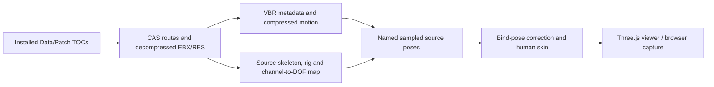

# Binary formats, animation logic and retargeting

These are observations from the tested FC 27 Lite build, not an official universal Frostbite specification. The executable readers in `tools/fc27/` are authoritative for this proof. Unsupported counts, routes, codecs and unresolved bindings should fail rather than be guessed.



## 1. Distinguish the layers

The archive reader locates bytes. Decompression recovers EBX metadata and RES payloads. The animation codec reconstructs numbered channels. Rig binding gives those channels semantic names. Retargeting adapts them to another skeleton. A game still needs action selection, blending, collision/contact decisions and match logic above those layers.

Extracting a clip does not extract the animation engine. A perfectly decoded tackle can still look wrong if played against the wrong actor, wrong origin or different timebase.

## 2. Layout and CAS routing

`Data/layout.toc` contains a Frostbite DB object beginning at byte 556 in this build. Its `installManifest.installChunks` entries map signed `persistentIndex` catalog IDs to `installBundle` paths. Do not assume catalog ID is an array index or that every CAS is in the same folder.

The small DB reader uses a tag's low five bits for type and the high bit for whether a name is omitted. It supports the container/string/bool/numeric/GUID/hash/blob types actually encountered here. Containers carry a varint byte length. GUIDs use little-endian GUID bytes. Unknown types are not silently skipped.

Each scanned TOC has fifteen big-endian u32 header fields at byte 556. Used fields are bundle-table offset and bundle count. A bundle-table entry is big-endian `u32, u32, u64`; the final value locates its routing header relative to 556. That header is nine big-endian u32s. Used fields locate route flags, route count and route entries relative to the bundle base.

For each route flag, a set high bit introduces `patch:u16, catalog:i32, cas:u16`, all big-endian. Then read `offset:u32, size:u32`, also big-endian. Other entries inherit the preceding route triple. **Use `flag & 128`; FC27 emitted 0x84, so checking equality with 128 fails.**

Resolve the route through:

```text
<game>/<Data-or-Patch>/<installBundle>/cas_<number padded to 2 digits>.cas
```

The route's patch field chooses Data/Patch, not simply the TOC's own folder. Scan every Data TOC first, then Patch TOCs, replacing the same `(kind, assetName)` record. Keep EBX and RES distinct even if they share a name.

The first route is bundle metadata. In that blob, counts begin at byte 8 as seven little-endian u32s: total, EBX count, RES count, chunk count, string-table offset and two metadata fields. Validate `total == EBX + RES + chunks` and route count `total + 1`.

At byte 36 is a 20-byte-per-asset SHA1 table. Next are EBX+RES pairs of little-endian name offset and original decoded size. Name location is `stringOffset + 4 + nameOffset`. RES type IDs follow those pairs, then 16-byte RES metadata and 8-byte resource IDs. Motion resources of interest have type `0x4088bf7e`, AnimationAssetRelocResource. This resource type does not guarantee every payload uses VBR.

## 3. Frostbite compression blocks and integrity

Each selected CAS payload consists of blocks with an eight-byte header:

| Bytes | Read | Meaning |
| --- | --- | --- |
| 0..3 | big-endian u32, mask 0xFFFFFF | Decoded block length |
| 4..5 | little-endian u16 | Codec/length bits |
| 6..7 | big-endian u16 | Low compressed-length bits |

Full compressed length is the low length OR `(((type >> 8) & 15) << 16)`. Codec is `type & 127`.

| Codec | Implementation used |
| --- | --- |
| 0 | Uncompressed bytes |
| 9 | `lz4.block.decompress`, explicit decoded size |
| 15 | `zstandard.ZstdDecompressor`, bounded output size |
| 17, 21, 25 | `OodleLZ_Decompress` from the installed game's Windows x64 DLL |

The Oodle binding is in `Archives.decompress()`. It declares the full pointer/size argument types, uses a bounded output buffer and checks the returned size. It does not run the game, patch an executable or bypass an entitlement.

Validate each decoded block and the final original asset size. The archive SHA1 matched packed bytes for some entries and decoded bytes for others, so compute both and require a match. Keep both in the manifest. Never treat a JSON file being written as integrity proof.

## 4. RIFF EBX, EFIX and relative pointers

The selected EBX files are RIFF containers. Starting at byte 12, sections have a four-character name, little-endian u32 length, payload and padding to an even boundary. `EFIX` describes types, object positions, imports and relocations.

Used EFIX order:

1. File GUID, 16 bytes, little-endian GUID representation.
2. Counted class GUID array.
3. Counted u32 signatures, exported-object count.
4. Counted u32 object offsets, followed by two further counted u32 arrays.
5. Counted imports, each containing file GUID and class GUID.
6. Counted import offsets and resource offsets.
7. Array-area offset, an unknown u32, string-area offset.

An object base in this build is `32 + objectOffset`. An external object reference is an odd u64; its import-array index is `reference >> 1`. Validate that index before using it.

A serialized array field contains a signed little-endian relative i64 pointer. The target is `addressOfPointer + relativeValue`. An element count u32 lives immediately before the target. Arrays of string pointers similarly contain relative pointers at each element address. Bounds and counts must be checked before allocating or iterating.

## 5. Source skeleton

Asset: `content/character/rig/skeleton/player/skeleton_player`.

Offsets below are relative to its root object base:

| Field | Offset | Element |
| --- | ---: | --- |
| BoneNames | 40 | Relative string pointer |
| BoneNameHashes | 56 | u32 |
| Hierarchy | 88 | signed parent index |
| ModelPose | 96 | 16 float32 values |
| LocalPose | 120 | 16 float32 values |

There are 369 bones in the tested file. Validate equal array lengths, unique names and parents preceding their children. Local transforms contain three basis vectors and a translation vector. They fit Three.js column storage; translation is at indices 12..14. Set matrix element 15 to 1 before decomposing into a Three.js affine transform because the stored fourth components are not a normal homogeneous matrix bottom row.

Source skeleton offsets are already meters. Animated source translation channels are in feet and are multiplied by 0.3048. Do not scale the rest skeleton twice.

## 6. VBR metadata and standalone RES

Locate the VBR object through EFIX object positions and verify its codec word at object+40. The bytes are `20 52 42 56`, often printed as ` RBV`, corresponding to little-endian tag `0x56425220`. Do not assume the object is always at the same absolute EBX offset: the recovery file contains other objects first.

Offsets relative to VBR object base:

| Field | Offset/type |
| --- | --- |
| CodecType, AnimID | 40, 44: u32 |
| TrimOffset, TrimmedDuration | 48, 52: float32 |
| EndFrame | 56: u16 |
| ChannelToDofAsset reference | 64: external u64 pointer |
| DofSetList reference | 72: external u64 pointer |
| BaseFlags, ResourceRef | 80, 88 |
| QuatMin, TrajMin, Vec3Min, FloatMin | 96,100,104,108: float32 |
| QuatMax, TrajMax, Vec3Max, FloatMax | 112,116,120,124: float32 |
| VectorOffsetScale, FloatOffsetScale, Dct | 128,132,136: float32 |
| Counts/sizes/flags below | consecutive u16s from 140 |

The u16 sequence is QuaternionCount, Vector3Count, FloatCount, ConstQuaternionCount, ConstVector3Count, ConstFloatCount, KeyTimeSize, NumKeys, ConstChanMapSize, ConstPaletteSize, VectorOffsetSize, FloatOffsetSize, Flags.

The standalone `.res` begins with three array descriptors. Palette count/pointer are at 0/4; frame-block-size count/pointer at 12/16; data byte count/pointer at 24/28. Palette entries are float32, block sizes are u16 and the data array is bytes. Validate all ranges against the resource length.

The logical data prefix is, in order: key-time RLE bytes, constant scalar codes, constant-channel map, animated scalar width table, vector offset data, float offset data, then compressed frame blocks.

For animated counts Q,V,F and constant counts CQ,CV,CF:

```text
expected = KeyTimeSize
         + 4*CQ + 3*CV + CF
         + ConstChanMapSize
         + 4*(4*Q + 3*V + F)
         + VectorOffsetSize + FloatOffsetSize
         + sum(FrameBlockSizes)
```

Each chosen RES had eight additional zero bytes after that logical data. Remove only a bounded, checked, all-zero tail. The host accepts 0..16 zero alignment bytes; it does not discard arbitrary bytes inside a stream.

## 7. Decoder adaptation and key sampling

The reference is the pinned FIFA17 fork's `VbrClip.cs`, fetched by `bootstrap_decoder.py`. It reconstructs constant/animated channels, per-block coefficients, float32 inverse-DCT values, range mapping and offset ramps; then it seeks key-time runs and interpolates source frames. The host supplies metadata through a functional getter, so the full Frosty runtime is unnecessary.

The crucial storage change: the FIFA17 reader reverses each compressed block body. The selected FC27 standalone resources store that body in forward order, beginning after its three-byte block prefix. The bootstrap changes that one body-copy expression. It does not replace quantization, logarithm basis, flags, channel maps or interpolation with approximations.

The old reversed interpretation produced invalid raw quaternion norms. Merely normalizing those values hid corruption. With forward storage, selected cinematic/idle p95 norm errors were about 0.00013–0.00032; gameplay samples about 0.0029–0.0036. Gameplay raw norms ranged roughly 0.993–1.007. Inspect validation JSON before sampling/rendering.

Output quaternions are **XYZW**. Source frames are sampled from 0 through EndFrame inclusive at a 30 Hz convention used by this proof. EndFrame is a last index, so frame count is EndFrame+1 and duration is `(frameCount-1)/30`. NumKeys is compressed key count and can differ from frame count. Do not stretch a 30-frame recovery to NumKeys seconds or infer time from its filename. Trim/additive/stategraph semantics beyond these chosen clips have not been implemented generically.

## 8. Bind numbered channels to DOFs

Use `antifreeze/assets/gameplay/common/player_rig_17` and the profile's named DOF dependencies. Root fields are DofSets at +56, DofIds at +72 and DofSetIdIndices at +80.

A set's start index is its corresponding DofSetIdIndices value; its end is the next valid index or the DofIds length. **0xffffffff is a sentinel. Skip it, and require `0 <= start <= end <= len(ids)` before any loop.** A naive loop over that sentinel caused a research process to allocate tens of GB; it was stopped and the bounds added. The cleaned tool has these checks.

Resolve each external DofSet GUID using `fc27-lite-profile.json`; verify the extracted file's own GUID. During original research, the GUID/name map was built by reading candidate antifreeze/ and _af/ EBX files and recording each file's first EFIX GUID against its asset name. The supplied 87-entry map avoids repeating that broad scan. For another build or rig, rebuild/verify that GUID index before extending the profile. Its LayoutData at root+40 is a u64 array containing a compiled layout blob. In that blob, a string-table base is a u32 at byte 16. Slots start at byte 32 with stride 32; their first four u32s are type, alignment, offset and name offset. A slot's name is the null-terminated string at stringBase+nameOffset. Zip the bounded set's DofIds interval with these slots.

For a clip, follow **that VBR object's +64 external reference** to its ChannelToDofAsset. Do not use import 0: the recovery EBX has six imports and its channel map is import index 2. The observed external channel assets are named `_af/<first 18 characters of file GUID>/toolchanneltodofassetdata`. This naming convention is a tested lookup rule, not a universal Frostbite promise. Read its u32 ID array at root+40 and resolve every ID through the rig map.

Channel types used here:

| Type | Meaning |
| --- | --- |
| 14 | Quaternion, name ending `.q` |
| 0x7a2e5497 | Vector3, commonly `.t` translation |
| 0x7a2e53c6 | Vector3 scale, `.s` |
| 10 | Scalar metadata such as foot velocity/height |

Preserve the order within each type when forming qNames/vNames/fNames. Counts must match decoded output. The current viewer ignores scale channels and the scalar contact metadata, but retains them in JSON. It is not automatically using extracted scalar metadata to detect ball or shirt contacts.

## 9. Runtime data schema

`data.json` contains:

```text
skeleton:
  BoneNames[bone], Hierarchy[bone], LocalPose[bone][16],
  ModelPose[bone][16], BoneNameHashes[bone]
clips[stem]:
  name, frameCount, fps,
  qNames[channel], quaternions[frame][channel][4],
  vNames[channel], vectors[frame][channel][3],
  fNames[channel], floats[frame][channel]
```

The extraction pipeline also stores diagnostic padding metadata. That field is not used in playback. Existing historical samples used `removeAt` instead; the comparison tool ignores only those two diagnostic keys.

At display time compute `frame = clamp(t*30,0,last)`, use adjacent source frames and fractional interpolation, normalize validated quaternions and use quaternion slerp. Vectors interpolate linearly. Reset source bones to rest pose before applying channels, preserving unanimated bones.

## 10. Retarget onto the human model

The target is Quaternius Superhero_Male_FullBody with a 65-bone skin, cloned with `SkeletonUtils.clone` so each player has independent bones. Main mappings include:

| Target | Source |
| --- | --- |
| pelvis | Hips |
| spine_01 / spine_02 / spine_03 | Spine / Spine1 / Spine3 |
| neck_01 / Head | Neck / Head |
| clavicle_l / upperarm_l / lowerarm_l / hand_l | LeftShoulder / LeftArm / LeftForeArm / LeftHand |
| thigh_l / calf_l / foot_l / ball_l | LeftUpLeg / LeftLeg / LeftFoot / LeftToeBase |

Right-side mappings mirror names. Finger chains map the three target finger bones to available source finger names. This is a practical mapping for the chosen model, not a universal Humanoid retargeter.

Store source rest-world rotations and target rest-world rotations before posing. For a mapped bone, compute a minimal alignment rotation A from the target rest child direction to the corresponding source rest child direction. Without this correction, target arms were held too high because bind directions differed.

Using quaternion multiplication in Three.js order:

```text
QtargetDesiredWorld = QsourcePoseWorld
                    * inverse(QsourceRestWorld)
                    * A
                    * QtargetRestWorld

QtargetLocal = inverse(QtargetParentPosedWorld) * QtargetDesiredWorld
```

Update target bones from parents to children. Reset target local rest positions/rotations before each pose. Copy the source hip world position into target pelvis-parent space; keep the target's own limb lengths. This can leave residual foot/hand placement differences. Use contact IK/warping later; do not claim perfect source contact after changing proportions.

The current game-derived source is Y-up in the new viewer. The older Gameplay Football physics/demo is Z-up. Integrate them through an explicit axis conversion; do not feed new Y-up positions directly into a solver whose gravity changes component 2.

## 11. Paired playback and camera

Matching source actor clips share a capture frame and trajectory. Play them at the same t. Choose one common scene origin, such as the mean of their initial AITrajectory positions in meters, and subtract it from both. Independently zeroing each actor's trajectory collapses their native relative placement.

The viewer follows the mean hip position horizontally, keeps a readable vertical target and widens camera distance on a narrow viewport. This camera change does not alter source animation. At the end it holds a pose briefly before replay; the clock keeps advancing through the hold. Clamping the playback clock itself to duration prevents replay and creates the old freeze symptom.

## 12. Independent collision prototype and future game logic

`physics.js` provides closest segment points, capsule overlap and conservative swept sphere/capsule contact. The earlier demo updates at 120 Hz, moves limb capsules with animated joints, accounts for moving-foot velocity in the ball impulse, then applies gravity, pitch bounce and damping. Contact triggers a fall; a limited classifier distinguishes ball-first, late and dangerous contact. These are authored gameplay heuristics, not official football-law adjudication or EA code.

For the next game, maintain a deterministic simulation clock separate from rendering. Decide an incident/action from positions, approach angle, relative speed and ball possession; choose a compatible source clip or pair; align roots within bounded tolerances; record timed foot/hand/contact windows; then blend into locomotion or recovery. Use ball sweeps and limb/body proxies to check actual contacts. Add foot IK and hand constraints where proportions or root warping disturb placement.

Start with a few authored scenarios and preserve clean transitions. Do not use arbitrary ragdoll motion to replace every fall, or select a front/side/back clip by a name alone. Those are next implementation steps, not features already present in the current viewer.
